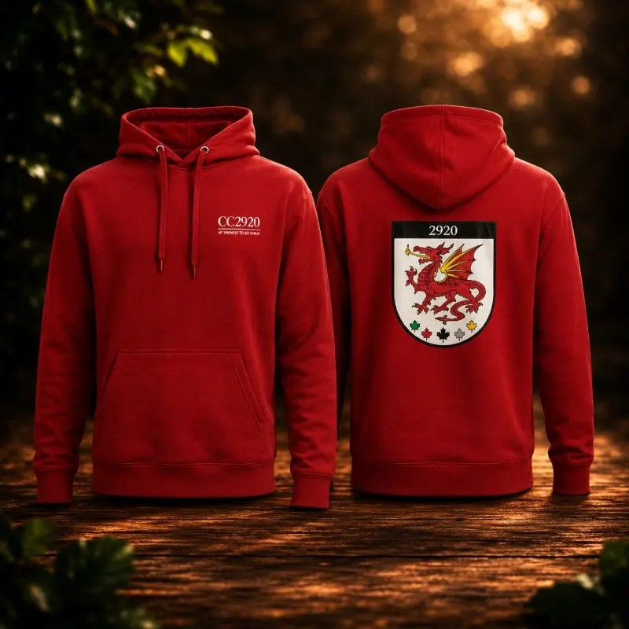
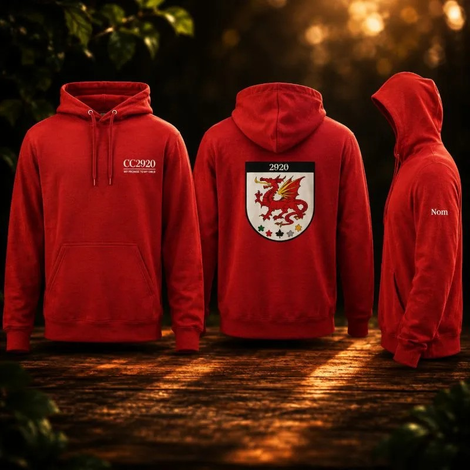

## Soirée d’instruction 13 novembre
- **Qui :** tous
- **Heure :** de 18h30 à 21h15, vendredi soir
- **Lieu :** [52 rue Saint-Rosaire, Gatineau](https://www.google.com/maps/search/52+rue+Saint-Rosaire,+Gatineau)
- **Tenue :** sport intérieur et extérieur, bouteille d’eau.

[Guide des tenues](https://cc2920.us21.list-manage.com/track/click?u=eadebede776501f499284ae20&id=d92d722dc9&e=0b8a47f805)

## Activités à venir
- 14 novembre : instruction intensive pour recrues, clinique de musique
- 21 novembre : guignolée, compétition de biathlon
- 28 novembre : course d’orientation
- 12-13 décembre : secourisme

## Instruction intensive pour recrues 14 novembre
- **Qui :** les recrues nées avant le 1er janvier 2013
- **Quand :** 14 novembre de 13h à 16h
- **Lieu :** [100 rue de la Baie, Gatineau](https://maps.app.goo.gl/DnFTU7ALrTDhjDoQ9)
- **Tenue :** C5
- Les recrues nées plus âgées, vous avez l’opportunité de sauter de niveau d’instruction au niveau rouge ou argent afin d’être avec d’autres jeunes de votre âge. Cette journée d’instruction intensive se veut de vous préparer à cette transition. 

## Compétition de biathlon
- **Qui :** Les cadets faisant parti de l'équipe de biathlon patrouilleur
- **Quand :** 21 novembre à 9h45
- **Lieu :** [Centre d'entraînement Connaught (CTC Connaught)](https://maps.app.goo.gl/5cavLgwDuEQte2eJ9)
- **Transport :** Les familles devront prévoir le transport aller-retour, le covoiturage entre les familles est encouragé afin de faciliter les déplacements.
- **Repas**: Les cadets devront apporter un dîner froid ainsi que des collations pour la journée.
- **Important**: La date limite pour retourner le formulaire d'autorisation est la soirée d’instruction du **13 novembre**.
- Les parents sont invités à consulter le document ci-dessous pour prendre connaissance de l'horaire, de la tenue et du matériel requis, ainsi que pour remplir le formulaire de confirmation de présence. [Lettre d'information - Compétition de biathlon](/docs/ressources/lettre-dinformation-biathlon.pdf)

## Course d’orientation 28 novembre
- L’activité fait partie du programme d’instruction obligatoire pour tous les niveaux. Il s’agit d’un avant-midi de formation sur la navigation suivie d’une course d’orientation en après-midi.
- L’information est disponible ici  : [Orienteering.pdf](https://1drv.ms/b/c/eec907a8a97cc844/IQAH8El7xFTuRp6RjGHCrgrhAck3kjAQyS5ij04fDA1EwFU?e=ChMQvS)

## Tir 
- **Qui :** tous les cadets ayant déjà passé l’évaluation de tir
- **Quand :** les lundis de 18h15 à 21h
- **Lieu :** [100 rue de la Baie, Gatineau](https://maps.app.goo.gl/DnFTU7ALrTDhjDoQ9)
- **Tenue :** civile

## Musique
- **Qui :** tous les cadets intéressés
- **Quand :** les dimanches de 8h45 à 13h.
- **Lieu :** [188 Alexandre-Taché, Gatineau](https://maps.app.goo.gl/2P8uYhaVri9YqjkJA)
- **Tenue :** civile
  

## Peloton de précision
- **Qui :** tous les cadets intéressés
- **Quand :** les mercredis de 18h30 à 20h30
- **Lieu :** [100 rue de la Baie, Gatineau](https://maps.app.goo.gl/DnFTU7ALrTDhjDoQ9)
- **Tenue :** civile avec les bottes de parade si vous l’avez. Apportez une bouteille d’eau et des collations si vous le désirez.
  
  
## Biathlon
- **Qui :** tous les cadets intéressés
- **Quand :** les samedis de 10h à 12h, compétition inter-unité le 21 novembre.
- **Lieu :**  variable. Pour le 14 novembre, 625 boul. du Carrefour](https://www.google.com/maps/search/625+boul.+du+Carrefour)
- **Tenue :** sport extérieur. Apportez collation et bouteille d’eau.
- Voici le plan d’entraînement proposé pour cette semaine : [Plan d'entrainement - semaine ](https://csdraveurs-my.sharepoint.com/:w:/g/personal/marieevebarrette_cssd_gouv_qc_ca/IQA1RY5w_p4RRLf23GSypxdjAShLqH4Eyt1tX4YeGgUYdJI?e=1LKrEC)

## Habillement
- **Fermeture du QM :** Veuillez prendre note que le QM sera fermé le mercredi 11 novembre.
- **Manteaux de biathlon :** Petit rappel aux cadets qui ont emprunté un manteau de biathlon, celui-ci doit être retourné au QM dans les meilleurs délais.
  

## Hoodie 
C’est la **dernière semaine** pour passer votre commande! 

Cadets, parents et membres du personnel, ne manquez pas l’occasion d’obtenir votre chandail à capuchon aux couleurs du Corps de cadets 2920 Gatineau. Une belle façon d’afficher votre fierté et votre sentiment d’appartenance!

- **Comment commander?** Vous pouvez passer votre commande directement sur notre [boutique officielle du CC2920](https://www.zeffy.com/fr-CA/ticketing/casquettes-cc2029) en cliquant sur les liens plus bas ou en personne à la cantine du Corps de cadets, les vendredis soir.
- **Date limite pour commander :** 15 novembre 2026
- **Réception prévue :** dernière semaine de novembre ou première semaine de décembre.

Une belle idée de cadeau de Noël! C’est votre dernière occasion de réserver votre hoodie. Ne tardez pas!

  <a href="https://www.zeffy.com/fr-CA/ticketing/casquettes-cc2029#:~:text=Chandail%20coton%2Douaté"
     class="boutique-lien"
     target="_blank"
     rel="noopener noreferrer"
     aria-label="Commander le coton-ouaté du CC2920 sur notre boutique en ligne">
    

      

        
      

      

        <strong>Chandail coton-ouaté</strong>
        
45 $

      

    

  </a>
  
  <a href="https://www.zeffy.com/fr-CA/ticketing/casquettes-cc2029#:~:text=Chandail%20coton%2Douaté%20personnalisé"
     class="boutique-lien"
     target="_blank"
     rel="noopener noreferrer"
     aria-label="Commander le coton-ouaté personnalisé du CC2920 sur notre boutique en ligne">
    

      

        
      

      

        <strong>Chandail coton-ouaté personnalisé</strong>
        
50 $

      

    

  </a>

## Grand tirage du panier de Noël
Le Comité de soutien du Corps de cadets 2920 de Gatineau organise une levée de fonds avec le tirage d'un magnifique **panier cadeau de Noël d'une valeur de 250 $**!

Nos cadets ont reçu lors de la soirée du 6 novembre une enveloppe contenant **30 billets à vendre au coût de 0,99 $ chacun**. Voici comment participer à cette belle initiative!

#### Comment fonctionne la vente ?
- Chaque cadet reçoit 30 billets à vendre.
- Les billets peuvent être proposés à la famille, aux amis, aux voisins, aux collègues de travail des parents, etc.
- Chaque billet vendu coûte seulement 0,99 $.
- Vous aimeriez en vendre davantage? Des billets supplémentaires sont disponibles à la cantine!

#### Retour des billets et de l'argent

Au plus tard le **11 décembre 2026**, chaque cadet doit remettre à la cantine :
- Les billets vendus;
- L'argent recueilli pour les billets vendus;
- Tous les billets invendus.

**Le tirage aura lieu dans la soirée du 18 décembre 2026**, lors de l'activité spéciale de Noël.

Un prix sera également remis aux **trois cadets ayant vendu le plus de billets**!

Nous comptons sur la participation de nos cadets, de leurs familles et de leur entourage pour faire de cette collecte un succès. Chaque billet vendu contribue directement à soutenir les activités et les projets de nos jeunes.

Merci de votre encouragement et bonne chance à tous! 

## Cartes-cadeaux - Achat (Fundscrip)
Achetez des cartes-cadeaux via le site [Fundscrip](https://www.fundscrip.com/soutenir-un-groupe/EWCCDU) et encouragez le Corps de cadets du même coup. Pour chaque fournisseur, vous verrez un pourcentage, c'est le pourcentage de remise que le fournisseur remettra au CC2920. Plus vous achetez, plus c'est profitable pour nos cadets.

#### Comment ça fonctionne ?
Laissez-vous guider par ce petit manuel illustré pour configurer votre compte et faire vos premiers achats : [**Guide de démarrage rapide**](/docs/fundscrip-Guide%20de%20d%C3%A9marrage%20rapide.pdf) (PDF).

  

Si vous avez des questions, n’hésitez pas à nous contacter à <2920armee@cadets.gc.ca>.
